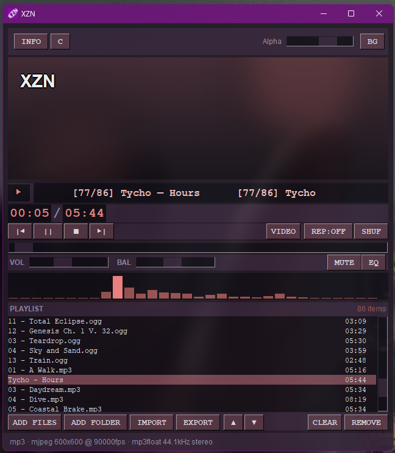
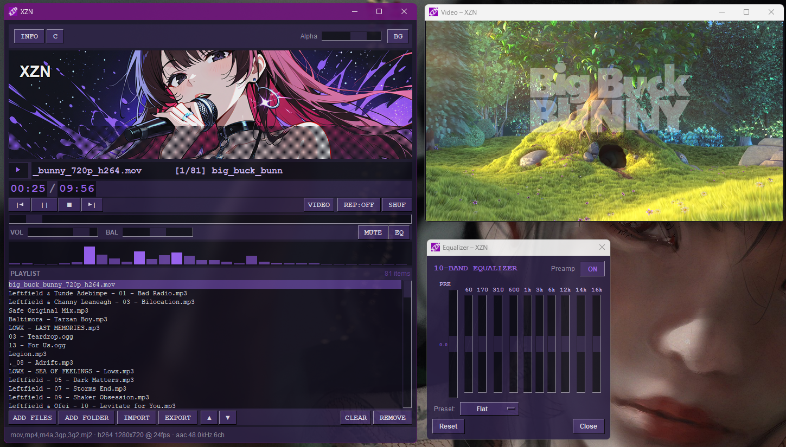

# Xenon Zones (XZN)

A classic media player with a cyberpunk look — video, audio,
10-band EQ, playlists and more. Built in Python.

## Screenshots





## Features

- Audio + video playback (via PyAV / FFmpeg)
- 10-band graphic equalizer with presets
- Playlist with drag & drop, M3U / M3U8 import & export
- Custom accent colors & alpha transparency
- Background images (choose your own)
- Fullscreen video window
- Auto-saves playlist & settings on every change

## Requirements

- Python 3.10+
- FFmpeg libraries (bundled with the `av` wheel usually)

## Installation

```bash
git clone https://github.com/merecete/xenon-zones.git
cd xenon-zones
python -m venv .venv
# Windows:
.venv\Scripts\activate
# Linux/macOS:
source .venv/bin/activate

pip install -r requirements.txt
