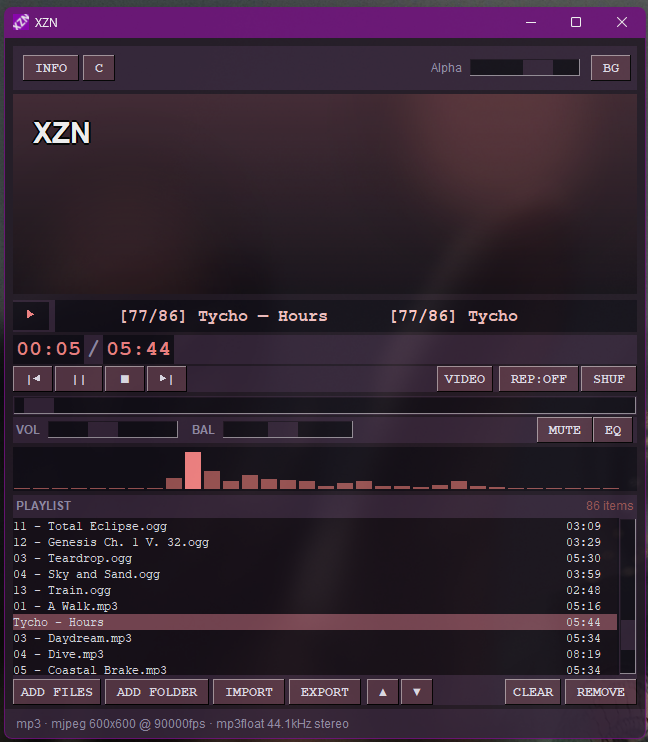
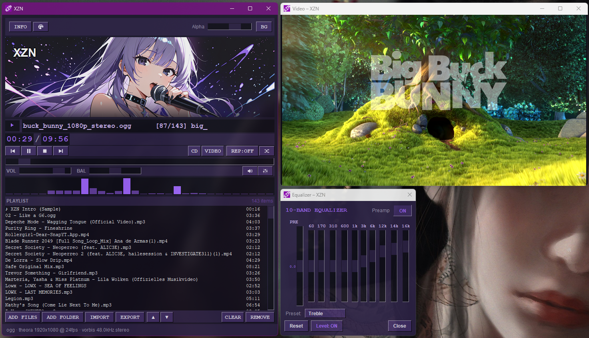
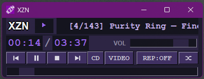
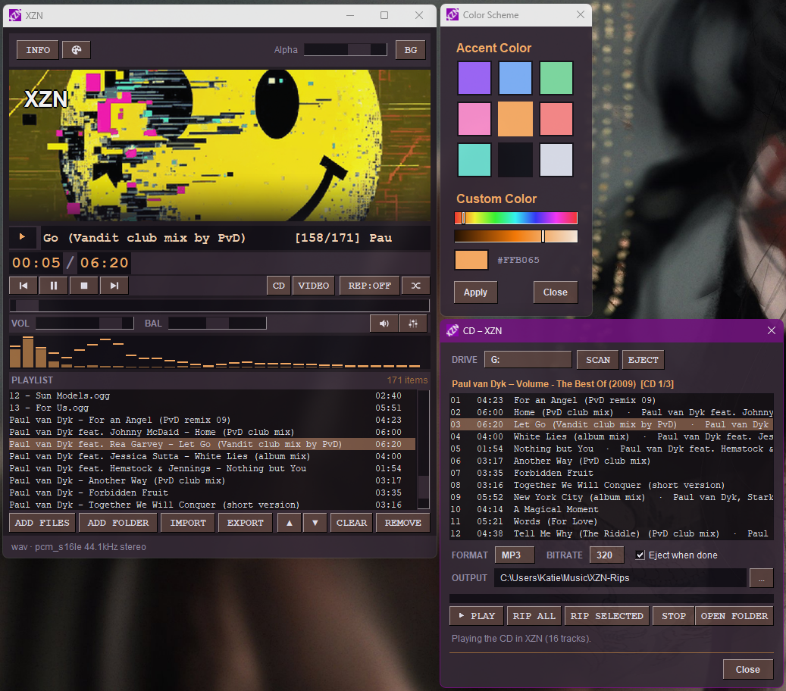
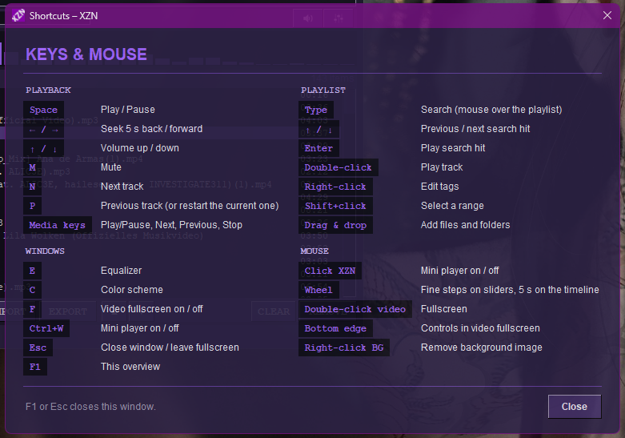

# Xenon-Zones (XZN)

Xenon-Zones (XZN) is a lightweight, cross-platform media player for Windows, Linux and macOS. Built with a focus on low resource consumption and a clean user experience, it is ideal for laptops, VMs and minimal setups. XZN stands out with its customizable cyberpunk interface and animated backgrounds, and it plays and rips audio CDs without any additional software.


## Screenshots











## Features

**Playback**
- Audio and video playback (via PyAV / FFmpeg) in all common formats, from MP3, AAC, FLAC and Opus
  to WavPack, Musepack, DSD, AIFF, MKV, VOB, AVCHD (.mts) and RealMedia
- Gapless playback and ReplayGain volume leveling
- Resumes where you left off
- 10-band graphic equalizer with presets and a spectrum analyzer
- Video window with fullscreen controls

**Audio CDs**
- Play CDs directly, with artist and track titles from MusicBrainz
- Rip all or selected tracks to MP3, OGG, Opus, AAC, FLAC, ALAC, WAV, AIFF or WavPack, fully tagged
  (with ReplayGain) and sorted into album folders
- No extra tools needed on Windows, Linux or macOS

**Playlist**
- Drag & drop, reordering (drag rows with the mouse or use the arrow buttons),
  M3U / M3U8 export, M3U / M3U8 / PLS / XSPF import
- Type-to-search (mouse over the playlist and start typing)
- Click the PLAYLIST header to hide or show the playlist
- Tag editor for audio files (ID3, Vorbis, MP4, APE and WMA tags)
- Auto-saves playlist and settings on every change

**Interface**
- Mini player (click the XZN logo or press Ctrl+W)
- Media key support
- Custom accent colors, alpha transparency and background images (including animated GIF / WebP)
- Button tooltips and a shortcut overview (F1)

## Download

Ready-made installers for **Windows**, **Linux** (`.deb` / `.tar.xz`) and **macOS** (`.dmg`) are available on the [Releases](../../releases) page.

## Running from source

Requirements:

- Python 3.10+ with Tk
- Linux only: `sudo apt install python3-tk libportaudio2`

The FFmpeg libraries come with the `av` package, no separate installation is needed.

```bash
git clone https://github.com/Merecete/XZN.git
cd XZN
```

**Windows**

```bat
python -m venv .venv
.venv\Scripts\activate
pip install -r requirements.txt
python xzn.py
```

**Linux / macOS**

```bash
python3 -m venv .venv
source .venv/bin/activate
pip install -r requirements.txt
python3 xzn.py
```

## Building the installers

See [installer/README.md](installer/README.md). One script per platform builds XZN and the matching package.

## License

Released under the BSD 3-Clause License. See [LICENSE.txt](LICENSE.txt) for details.

The ready-made packages also contain third-party libraries (FFmpeg via PyAV, mutagen, NumPy, SciPy,
Pillow, libsndfile and others), each under its own license. They are listed in
[THIRD_PARTY_NOTICES.txt](THIRD_PARTY_NOTICES.txt); the full texts ship in the `licenses` folder of every package
and are shown in XZN under Info → License.
