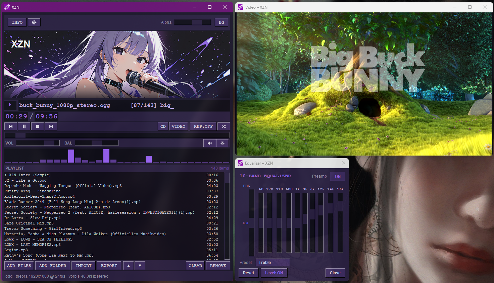
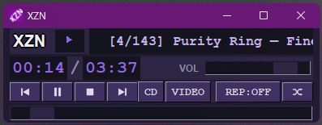
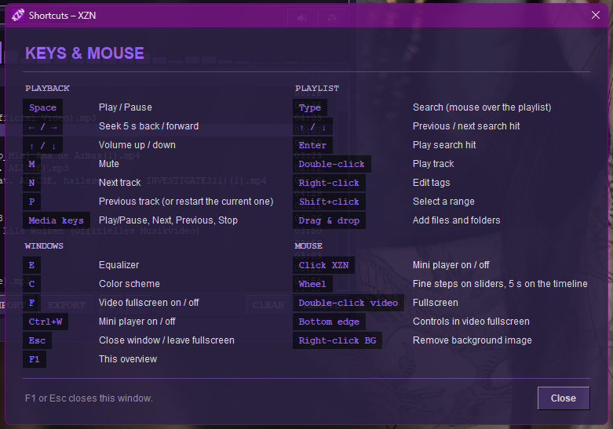

# Xenon-Zones (XZN)

Xenon-Zones (XZN) is a lightweight, cross-platform compiled media player for Windows, Linux, and macOS. Built with a focus on low resource consumption and a clean user experience, it is ideal for laptops, VMs, and minimal setups. XZN stands out with its modern, customizable interface and unique animated background support, offering a simple yet highly adaptable media playback experience

## Screenshots








## Features

- Audio + video playback (via PyAV / FFmpeg)
- 10-band graphic equalizer with presets
- Playlist with drag & drop, M3U / M3U8 import & export
- Custom accent colors & alpha transparency
- Background images (choose your own)
- Fullscreen video window
- Auto-saves playlist & settings on every change
- Mini Player
- Seamless transitions

## Requirements

- Python 3.10+
- FFmpeg libraries (bundled with the `av` wheel usually)

## Installation

```bash
git clone https://github.com/Merecete/XZN.git
cd XZN


## Windows:

python -m venv .venv

.venv\Scripts\activate

pip install -r requirements.txt

python xzn.py


## Linux/macOS:

python3 -m venv .venv

source .venv/bin/activate

pip install -r requirements.txt

python3 xzn.py
