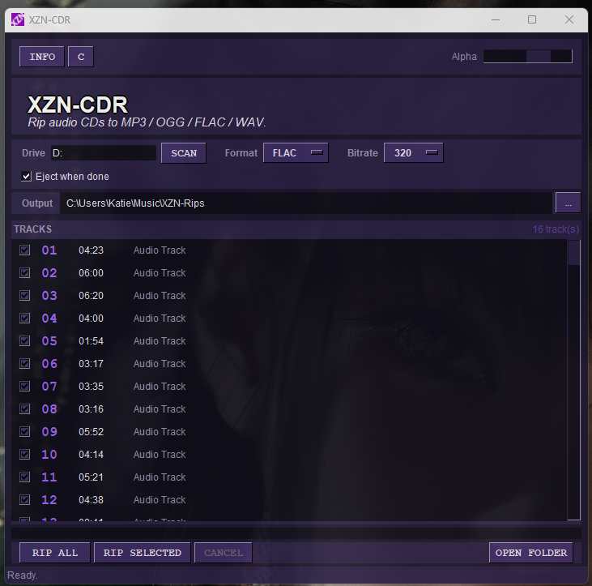

# Xenon-Zones CD-Ripper (XZN-CDR)

Companion CD ripper that converts audio CDs
to MP3 / OGG / FLAC / WAV, with the same look like XZN.

## Screenshots



## Features

- Converts CD audio tracks into all common formats
- MP3, OGG, FLAC & WAV
- Bitrates 128, 192, 256, 320

## Requirements

- Python 3.10+
- **ffmpeg** on every platform (used for encoding to MP3 / OGG / FLAC)
    - **Windows:** must be a **full** build with `libcdio` support
      (e.g. [ffmpeg-release-full from gyan.dev](https://www.gyan.dev/ffmpeg/builds/))
    - **Linux / macOS:** any recent build from your package manager is fine
- **Pillow** (for the Info window logo) — installed via `requirements.txt`

## CD backend per platform

The ripper picks the right backend at runtime, so there's a single
`xzn-cdr.py` for all platforms:

Windows: `ffmpeg -f libcdio` | just the ffmpeg full build above  
Linux: Linux `pycdio` | libcdio-dev`, `libcdio-cdda-dev` then `pip install -r requirements.txt`
Mac: `cd-paranoia` | `brew install libcdio-paranoia ffmpeg`

## Installation

```bash
## Windows:

git clone https://github.com/Merecete/Xenon-Zones.git

cd Xenon-Zones/xzn-cdr

python -m venv .venv

.venv\Scripts\activate

pip install -r requirements.txt

##  Linux:

git clone https://github.com/Merecete/Xenon-Zones.git

cd Xenon-Zones/xzn-cdr

python3 -m venv .venv

source .venv/bin/activate

pip install -r requirements.txt

## macOS:

git clone https://github.com/Merecete/Xenon-Zones.git

cd Xenon-Zones/xzn-cdr

Install the two native tools via Homebrew: brew install libcdio-paranoia ffmpeg
if you don't have Homebrew:
/bin/bash -c "$(curl -fsSL https://raw.githubusercontent.com/Homebrew/install/HEAD/install.sh)" )

python3 -m venv .venv

source .venv/bin/activate

pip install -r requirements.txt
